    
    

    
    
    
    
    
    

    <strong>Requires the latest versions of <a href="https://github.com/acemod/ACE3/releases">ACE3</a> and <a href="https://github.com/CBATeam/CBA_A3/releases">CBA A3</a>. 
    Visit us on <a href="https://twitter.com/ACE3Mod">Twitter</a> | <a href="https://www.facebook.com/ACE3Mod">Facebook</a> | <a href="https://www.youtube.com/c/ACE3Mod">YouTube</a> | <a href="https://www.reddit.com/r/arma/search?q=ACE&restrict_sr=on&sort=new&t=all">Reddit</a></strong>

**BACED** is an effort by the teams behind **Black Templars' Armoury**, **Crossing the Rubicon** and **Tactical Dreadnought Armoury** to improve the realism and authenticity of 40K Arma 3.

BACED is a patch mod for [ACE3](https://github.com/acemod/ACE3): you keep ACE3 in your modlist and load BACED alongside it. BACED only replaces the parts of ACE3 it changes for 40K, so using it should not make you fall behind in ACE3 updates!

## Core features

- Medical system rework for Space Marines

### Additional features

- 
***and much more...***

## Getting started

BACED requires Arma 3 and the latest versions of <a href="https://github.com/acemod/ACE3/releases">ACE3</a> and <a href="https://github.com/CBATeam/CBA_A3/releases">CBA A3</a>. Load BACED alongside them; it does not replace ACE3.

## Contributing

You can help out with the ongoing development by looking for potential bugs in our code base, or by contributing new features. We are always welcoming new pull requests containing bug fixes, refactors and new features. We have a list of tasks and bugs on our issue tracker on Github. Please comment on issues if you want to contribute with, to avoid duplicating effort.

### Contribution guidelines

To contribute something to BACED, simply fork this repository and submit your pull requests for review by other collaborators. See [the pull request guidelines](https://github.com/Black-Templars-Team/BACED/wiki/Merging-Pull-Requests) for further information on this process.

### Submitting issues and requesting features

Please, use our [Issue Tracker](https://github.com/Black-Templars-Team/BACED/issues) to report a bug, propose a feature, or suggest changes to the existing ones. See also:
- [How to report an issue](https://github.com/Black-Templars-Team/BACED/wiki/How-to-Report-an-Issue)
- [How to make a feature request](https://github.com/Black-Templars-Team/BACED/wiki/How-to-Make-a-Feature-Request)

### Testing & building

To help us test the latest development changes, download the [artifact](https://github.com/Black-Templars-Team/BACED/actions/workflows/baced-arma.yml) of the branch you'd like to test or subscribe to "BACED Master" on the workshop to test the `baced` branch. Alternatively [build your own version](https://github.com/Black-Templars-Team/BACED/wiki/Setting-Up-the-Development-Environment).

### Get in touch

<table>
  <tr>
    <td><a href="https://discord.gg/blacktemplar-a3">Discord</a></td>
    <td>We have a public Discord server that anyone can join. This is where all our developers and contributors hang out and where we make announcements</td>
  </tr>

  <tr>
    <td><a href="https://twitter.com/ACE3Mod">Twitter</a></td>
    <td>You can follow our Twitter account to get updates and various links to guides</td>
  </tr>
  <tr>
    <td><a href="https://www.facebook.com/ACE3Mod">Facebook</a></td>
    <td>You can follow our Facebook account to get updates and various links to guides</td>
  </tr>

  <tr>
    <td><a href="https://forums.bistudio.com/topic/181341-ace3-a-collaborative-merger-between-agm-cse-and-ace/?p=2859670">Bohemia Forum</a></td>
    <td>We have a dedicated thread on the Bohemia Forums for the ACE3 project</td>
  </tr>
</table>

## License

BACED is licensed under the GNU General Public License ([GPLv2](https://github.com/Black-Templars-Team/BACED/blob/baced/LICENSE)).
